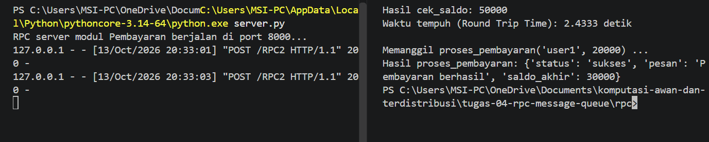

# Jurnal Proses — Tugas 4
**Kelompok:** [1]

| Nama | NIM | Kontribusi |
|---|---|---|
| Ida Ayu Putri Suryapatni Basundari | 103072400068 | Melengkapi code (TODO) client dan server, running code |
| I Wayan Juanesa Ryan Pradita | 103072430012 |  |

## Jalur yang dipilih
- [RPC ], alasan: ...

## Kendala teknis
- Error saat setup (mis. koneksi RabbitMQ ditolak, port bentrok): ...

## Uji "pesan tidak hilang" (khusus Jalur B)
- Langkah uji: matikan consumer → jalankan publisher → nyalakan consumer
- Hasil yang diamati: ...

## Log Penggunaan AI (Level 2)

> Wajib diisi sesuai kebijakan Level 2 di [`../RUBRIK-UMUM.md`](../RUBRIK-UMUM.md). Tulis "Tidak memakai AI" pada baris pertama jika memang tidak dipakai. Hanya untuk brainstorming ide/outline — bukan untuk kode/analisis/teks akhir.

| Tanggal | Tool AI | Prompt yang diberikan | Ringkasan saran/ide AI | Bagaimana diolah jadi tulisan/kode sendiri |
|---|---|---|---|---|
| 10-10-2026 | GEMINI | "C:\Users\MSI-PC\AppData\Local\Python\pythoncore-3.14-64\python.exe: can't open file 'C:\\Users\\MSI-PC\\OneDrive\\Documents\\komputasi-awan-dan-terdistribusi\\rpc\\client.py': [Errno 2] No such file or directory" saya mengalami error seperti ini, apa solusinya agar dapat running, lalu jika saya running melalui tombol run di vscode, yang berjalan hanya file server | Pesan error [Errno 2] No such file or directory muncul karena terminal Anda belum berada di dalam folder utama proyek, atau path file client.py belum sesuai dengan posisi direktori aktif Anda saat ini. Di panel Explorer (kiri VS Code), klik kanan pada folder rpc atau langsung pada file server.py. Pilih "Open in Integrated Terminal" (Buka di Terminal Terpadu). Terminal akan otomatis terbuka langsung di dalam folder rpc. Setelah terminal terbuka di folder rpc, Anda cukup menjalankan perintah yang singkat tanpa menuliskan rpc/: | - |
