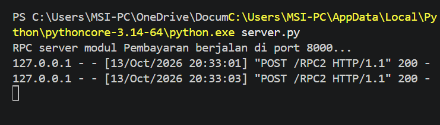
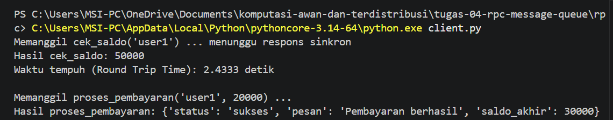

# Jurnal Proses — Tugas 4
**Kelompok:** [1]

| Nama | NIM | Kontribusi |
|---|---|---|
| Ida Ayu Putri Suryapatni Basundari | 103072400068 | Menyelesaikan semua code (TODO) client dan server, running code, analisis kendala saat running code |
| I Wayan Juanesa Ryan Pradita | 103072430012 | Memilih dan menerapkan Jalur A (RPC Sinkron), serta mengatasi kendala saat menjalankan program |

## Jalur yang dipilih
- [RPC], alasan: karena transaksi antara modul Pesanan sama Pembayaran di FoodGo butuh kepastian yang langsung (real-time). Jadi waktu user cek saldo atau bayar, modul Pesanan emang harus nungguin balasan dari modul Pembayaran dulu (sifatnya blocking) biar tau transaksinya sukses atau gagal sebelum pesanan diproses.
- 
- 
- 

## Kendala teknis
- Error Path/Folder ([Errno 2] No such file or directory): Sempet ketemu error ini pas awal-awal mau run kodenya. Penyebabnya karena posisi terminal belum masuk ke direktori/folder proyek yang pas, jadi Python nggak nemu file server.py atau client.py-nya.
- Masalah Run via Tombol Play VS Code: Pas klik tombol Play (segitiga) di VS Code, ternyata yang jalan cuma file yang lagi terbuka doang (server.py), dan terminalnya langsung kepakai terus buat server (blocking). Solusinya, kita harus buka 2 tab terminal terpisah di VS Code, satu terminal khusus buat nyalain server.py, dan satu lagi khusus buat run client.py.

## Log Penggunaan AI (Level 2)

> Wajib diisi sesuai kebijakan Level 2 di [`../RUBRIK-UMUM.md`](../RUBRIK-UMUM.md). Tulis "Tidak memakai AI" pada baris pertama jika memang tidak dipakai. Hanya untuk brainstorming ide/outline — bukan untuk kode/analisis/teks akhir.

| Tanggal | Tool AI | Prompt yang diberikan | Ringkasan saran/ide AI | Bagaimana diolah jadi tulisan/kode sendiri |
|---|---|---|---|---|
| 10-10-2026 | GEMINI | "C:\Users\MSI-PC\AppData\Local\Python\pythoncore-3.14-64\python.exe: can't open file 'C:\\Users\\MSI-PC\\OneDrive\\Documents\\komputasi-awan-dan-terdistribusi\\rpc\\client.py': [Errno 2] No such file or directory" saya mengalami error seperti ini, apa solusinya agar dapat running, lalu jika saya running melalui tombol run di vscode, yang berjalan hanya file server | Pesan error [Errno 2] No such file or directory muncul karena terminal Anda belum berada di dalam folder utama proyek, atau path file client.py belum sesuai dengan posisi direktori aktif Anda saat ini. Di panel Explorer (kiri VS Code), klik kanan pada folder rpc atau langsung pada file server.py. Pilih "Open in Integrated Terminal" (Buka di Terminal Terpadu). Terminal akan otomatis terbuka langsung di dalam folder rpc. Setelah terminal terbuka di folder rpc, Anda cukup menjalankan perintah yang singkat tanpa menuliskan rpc/: | - |
| 9-10-2026 | cloude | Jalur A — RPC (Sinkron), Jalur B — Message Queue / MOM (Asinkron). Dari 2 jalur ini yang mana paling efektif dan mudah digunakkan untuk komunikasi antar komponen, berikan saya alasannya | Tidak ada satu jalur yang selalu paling efektif. Jawabannya tergantung kebutuhan, tetapi jika harus memilih berdasarkan dua kriteria Anda, hasilnya terbagi seperti ini: Paling mudah digunakan: RPC (Jalur A). Paling efektif untuk komunikasi antar komponen secara umum: Message Queue / MOM (Jalur B). RPC paling tepat jika komponen berada dalam skala sistem yang tidak terlalu besar dan selalu aktif bersamaan seperti (misalnya e-commerce atau perbankan) | - |
