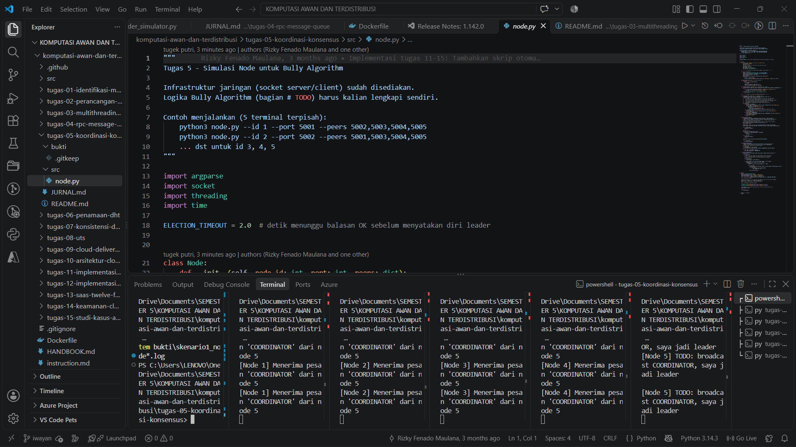
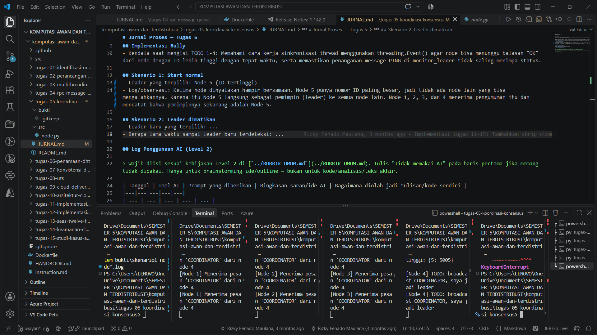

# Jurnal Proses — Tugas 5
**Kelompok:** [1]

| Nama | NIM | Kontribusi |
|---|---|---|
| Ida Ayu Putri Suryapatni Basundari | 103072400068 | Menyelesaikan semua code (TODO 1-4)  analisis kendala saat pengerjaan code |
| I Wayan Juanesa Ryan Pradita | 103072430012 | Me-run kode dan melanjutkan mengisi skenario 1 & 2 serta analisis pada file readme |

## Implementasi Bully
- Kendala saat mengisi TODO 1-4: Memahami cara kerja sinkronisasi thread menggunakan threading.Event() agar node bisa menunggu balasan "OK" dari node dengan ID lebih tinggi dengan tepat waktu, serta memastikan penanganan message PING di monitor_leader tidak saling menimpa status. Terkendala inisialisasi attribute, karena masih berusaha memahami bagaimana cara inisialisasi tiap atribute.

## Skenario 1: Start normal
- Leader yang terpilih: Node 5 (ID tertinggi)
- Log/observasi: Kelima node dinyalakan hampir bersamaan. Node 5 punya nomor ID paling besar, jadi tidak ada node lain yang bisa mengalahkannya. Karena itu Node 5 langsung sebagai pemimpin (leader) ke semua node lain. Node 1, 2, 3, dan 4 menerima pengumuman itu dan mencatat bahwa pemimpinnya sekarang adalah Node 5.

## Skenario 2: Leader dimatikan
- Leader baru yang terpilih: Node 4
- Berapa lama waktu sampai leader baru terdeteksi: +- 18 detik, Setelah Node 5 dimatikan, node 4 punya ID terbesar di antara node yang masih hidup, jadi akan mengambil alih sebagai pemimpin baru dan memberi tahu ke node 1, 2, dan 3.

## Log Penggunaan AI (Level 2)

> Wajib diisi sesuai kebijakan Level 2 di [`../RUBRIK-UMUM.md`](../RUBRIK-UMUM.md). Tulis "Tidak memakai AI" pada baris pertama jika memang tidak dipakai. Hanya untuk brainstorming ide/outline — bukan untuk kode/analisis/teks akhir.

| Tanggal | Tool AI | Prompt yang diberikan | Ringkasan saran/ide AI | Bagaimana diolah jadi tulisan/kode sendiri |
|---|---|---|---|---|
| 19-10-2026 | GPT | kenapa algoritma bully dia memilih id yang lebih tinggi sebagai leader dan kenapa tidak random aja, apa kelemahan yang biasanya di temui pada algoritma ini? | Bully Algorithm adalah memilih proses aktif dengan ID tertinggi, bukan proses yang dipilih secara acak. Aturan ini membuat pemilihan memiliki prioritas yang jelas dan hasil yang deterministik ketika asumsi algoritmanya terpenuhi. Kelemahan utamanya adalah overhead komunikasi, ketergantungan pada timeout dan deteksi kegagalan, serta risiko kepemimpinan ganda saat terjadi partisi jaringan. Karena itu, pada sistem terdistribusi modern, pemilihan leader sering dilengkapi dengan mekanisme lain seperti quorum, term/epoch, atau protokol konsensus untuk menjaga konsistensi. | Election Algorithm selalu memilih node ber-ID tertinggi yang masih hidup karena sebuah node hanya mau mundur kalau ada node lebih besar yang menjawab OK. Proses ini naik terus sampai ketemu node terbesar yang masih aktif, dan node yan paling besar itu menjadi leader. Pada kasus FoodGo, leader membuat urutan pesanan ditentukan di satu tempat saja, sehingga tidak lagi bergantung pada jam tiap server dan pesanan tidak diproses doubel. Namun, bisa muncul dua leader saat jaringan terputus, dan tidak menjamin data antrean ikut aman. Aloritma ini cukup untuk simulasi belajar dan cluster kecil yang jaringannya stabil. |
| 19-10-2026 | GEMINI | Apakah terdpata kesalahan penulisan pada code saya? Karena saat dicoba untuk running ada beberapa attribute yang tidak dikenal pada init | Bagian kode Anda yang salah sebelumnya beserta solusinya: 1. Belum Mendefinisikan self.ok_event di __init__ Bagian Salah: Objek ok_event tidak didefinisikan pada fungsi inisialisasi kelas (__init__), sehingga memicu error AttributeError: 'Node' object has no attribute 'ok_event'. Solusi: Tambahkan baris self.ok_event = threading.Event() di dalam blok __init__. 2. Menggunakan .item() pada Dictionary Bagian Salah: Pada baris iterasi peer (higher_peers.item() dan self.peers.item()), method yang digunakan keliru. Solusi: Ubah pemanggilan method tersebut menjadi .items(). 3. Ketidakcocokan Nama Pesan Koordinasi Bagian Salah: Pada fungsi penanganan pesan, tipe pesan diperiksa sebagai "COORDINATION", sedangkan pada saat deklarasi leader, pesan yang dikirimkan adalah "COORDINATOR". Solusi: Samakan penamaan tipe pesan tersebut menjadi "COORDINATOR" pada kedua bagian. 4. Kurang Huruf f pada f-string Print "OK" Bagian Salah: Baris print("[Node {self.node_id}] Menerima pesan 'OK' dari node {sender_id}") tidak mengenali variabel di dalam kurung kurawal. Solusi: Tambahkan huruf f di depan string pembuka (print(f"...")). |  |
