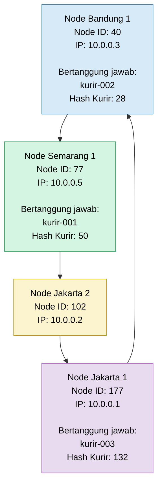

# Tugas 6 (Pekan 6) — Penamaan & Resolusi Lokasi

**Materi terkait:** Flat Naming, Structured Naming (DNS), Distributed Hash Table (DHT)/Chord.

## Studi Kasus

Pelanggan FoodGo kesulitan menemukan alamat IP server kurir yang **dinamis** (kurir berpindah lokasi/jaringan, IP-nya sering berubah). FoodGo butuh cara memetakan **ID Kurir** (identitas tetap) ke **alamat IP terkininya** tanpa server pusat tunggal yang jadi bottleneck/single point of failure.

## Tugas Kelompok

Implementasikan **simulasi Chord DHT** sederhana (single-process, tidak perlu jaringan sungguhan — cukup simulasi struktur data & algoritma di satu program Python) yang memetakan ID Kurir ke alamat IP mereka.

Konsep yang harus terlihat jalan dalam simulasi kalian:
1. **Consistent hashing**: ID Kurir dan ID Node di-hash ke ruang angka yang sama (mis. 0–255 untuk kesederhanaan, `m=8` bit).
2. **Ring topology**: node-node diurutkan melingkar berdasarkan hasil hash-nya.
3. **Lookup**: fungsi `lookup(kurir_id)` yang menemukan node mana yang bertanggung jawab menyimpan mapping ID Kurir tersebut → alamat IP-nya (aturan Chord: node dengan ID hash **terkecil yang lebih besar atau sama dengan** hash key, disebut *successor*).
4. **Perubahan topologi**: simulasikan minimal satu node baru bergabung (`join`) atau satu node keluar (`leave`), tunjukkan bagaimana mapping berpindah tanggung jawab ke node lain.

Skeleton disediakan di `src/chord_simulation.py` dengan fungsi hashing dan struktur ring sudah ada — bagian `lookup()`, `join()`, dan `leave()` sengaja dikosongkan.

### Cara Menjalankan

```bash
python3 src/chord_simulation.py
```

## Tugas Analisis (`README.md`)

1. Jelaskan **kenapa DHT/Chord** lebih cocok untuk kasus ini dibanding **flat naming sederhana** (mis. tabel pusat ID→IP) atau **DNS konvensional** — kaitkan dengan sifat "IP kurir sering berubah" dan kebutuhan tanpa titik gagal tunggal.
    1. Dibandingkan dengan Flat Naming Sederhana (Tabel Pusat ID $\rightarrow$ IP):
    - Kelemahan Flat Naming: Pendekatan ini biasanya menggunakan satu server atau database terpusat untuk memetakan ID Kurir tetap ke alamat IP terkininya. Ketika ribuan kurir bergerak secara masif dan IP mereka sering berubah, server pusat ini harus terus-menerus menerima dan memproses write requests (pembaruan data) yang masif secara bersamaan, sehingga memicu bottleneck. Selain itu, jika server pusat tersebut mengalami gangguan (down), seluruh sistem pelacakan kurir lumpuh total (SPOF).
    - Keunggulan DHT/Chord: Chord mendistribusikan beban penyimpanan pemetaan ke seluruh node yang aktif di dalam ring secara merata menggunakan consistent hashing. Tidak ada server pusat; setiap pembaruan IP kurir hanya dikirim dan dikelola oleh node spesifik (successor) yang bertanggung jawab atas kunci tersebut.
    2. Dibandingkan dengan DNS Konvensional:
    - Kelemahan DNS: Sistem Domain Name System (DNS) dirancang untuk arsitektur hierarkis dengan masa Time-to-Live (TTL) dan mekanisme caching yang agresif di tingkat klien maupun server perantara (resolver). DNS tidak efisien untuk entitas dengan mobilitas tinggi dan perubahan IP yang terjadi dalam hitungan detik/menit karena adanya propagation delay dari pembaruan record DNS. Selain itu, DNS tidak dirancang secara native untuk menangani dinamika churn (bergabung dan keluarnya node secara dinamis dan terus-menerus) dalam jaringan peer-to-peer skala besar.
    - Keunggulan DHT/Chord: DHT/Chord mampu melakukan resolusi lokasi secara real-time tanpa bergantung pada masa caching yang kaku. Ketika sebuah node bergabung (join) atau keluar (leave), struktur topologi ring secara otomatis melakukan penyesuaian (routing/successor update) dan memindahkan tanggung jawab data secara lokal, sehingga sangat adaptif terhadap perubahan jaringan kurir yang cepat.

2. Gambarkan (boleh pakai Mermaid, lihat Tugas 2) ring topology dari simulasi kalian, tandai node mana yang bertanggung jawab atas ID Kurir mana.

3. Jelaskan apa yang terjadi pada mapping saat sebuah node **keluar** dari ring (siapa yang mengambil alih tanggung jawabnya) — dukung dengan output program.
**Analisis Perubahan Topologi Saat Node Keluar**
- (Leave)Apa yang terjadi? Waktu ada node yang keluar dari ring (contohnya node-surabaya-1 dengan ID 136), data-data kurir yang tadinya diurus sama node itu gak boleh sampai hilang.   
- Siapa yang ambil alih? Otomatis, tanggung jawab buat ngurusin data tersebut bakal dialihkan dan diambil alih sama node successor (penerus) terdekat berikutnya yang masih aktif di dalam ring.   
- Bukti dari Output Program:
    - Kalau kita lihat dari hasil running program di terminal, pas node-surabaya-1 keluar, sistem langsung ngejalanin proses transfer data:
    [LEAVE] Node 'node-surabaya-1' (id=136) keluar dari ring. Key yang ditransfer ke successor baru: [('kurir-003', 132, 177)]
- Dari log itu keliatan kalau key kurir-003 (yang punya nilai hash 132) tadinya dipegang sama node 136, terus dipindahin ke node ID 177 (node-jakarta-1) sebagai successor barunya. Makanya, pas kita coba lakukan lookup(kurir-003) setelah nodenya keluar, sistem tetep bisa nemuin IP kurirnya (192.168.1.12) dengan normal tanpa ada data yang ilang (zero data loss).
## Struktur Submission

```
tugas-06-penamaan-dht/
├── README.md      # Analisis + diagram ring
├── JURNAL.md
├── src/
│   └── chord_simulation.py
└── bukti/          # Output program (screenshot/log) untuk skenario join & leave
```

## Rubrik Penilaian (Tugas 6)

| Komponen | Bobot | Kriteria |
|---|---|---|
| Implementasi lookup/join/leave benar | 35% | Consistent hashing & successor lookup sesuai aturan Chord |
| Bukti perubahan topologi (join/leave) | 25% | Output menunjukkan mapping berpindah dengan benar |
| Analisis kenapa DHT vs flat naming/DNS | 25% | Argumen spesifik ke kasus IP kurir dinamis, bukan definisi umum |
| Proses & kontribusi kelompok | 15% | `JURNAL.md`, commit history |

## Batasan Penggunaan AI (Level 2)

Kebijakan **Level 2 (AI Assisted Idea Generation & Structuring)** berlaku — lihat [`../RUBRIK-UMUM.md`](../RUBRIK-UMUM.md). Boleh bertanya konsep umum consistent hashing/Chord ke AI; **tidak boleh** meminta AI menuliskan isi `# TODO` di `src/chord_simulation.py` (`find_successor`, `join`, `leave`, dst). Catat pemakaian AI di "Log Penggunaan AI" pada `JURNAL.md`.

- `README.md` wajib menelusuri manual (langkah demi langkah) bagaimana `lookup()` menemukan successor untuk salah satu ID Kurir contoh yang dipakai di `chord_simulation.py` — bukan cuma menempelkan output program.
1. Inisialisasi & Perhitungan Hash ID Kurir:
- Ambil contoh dari terminal: kurir-001 yang menghasilkan nilai hash hash = 50.   
2. Daftar Node Aktif di Ring (Saat Lookup Pertama):
- Berdasarkan log terminal, node-node yang bergabung di awal beserta ID-nya adalah:   
    - node-bandung-1 $\rightarrow$ id = 40   
    - node-jakarta-2 $\rightarrow$ id = 102   
    - node-surabaya-1 $\rightarrow$ id = 136   
    - node-jakarta-1 $\rightarrow$ id = 177   
- Jika diurutkan menaik (sorted), daftar ID node di ring adalah: [40, 102, 136, 177].
3. Penerapan Aturan Successor Chord:
- Aturan Chord menetapkan bahwa successor dari sebuah key adalah node dengan ID terkecil yang bernilai lebih besar atau sama dengan ($\ge$) dari key_hash ($50$).
4. Evaluasi Berurutan pada Daftar Node:
- Cek Node 40: Apakah $40 \ge 50$? Salah ($40 < 50$). Lanjut ke node berikutnya.
- Cek Node 102: Apakah $102 \ge 50$? Benar! ($102 \ge 50$).
5. Kesimpulan Lookup:
- Node dengan ID 102 (node-jakarta-2) ditetapkan sebagai successor yang sah untuk mengelola kurir-001 (hash=50).  
- Fungsi lookup() kemudian mengembalikan alamat IP kurir tersebut yaitu 192.168.1.10. Sesuai dengan output terminal: lookup(kurir-001): hash=50 -> node id=102.   